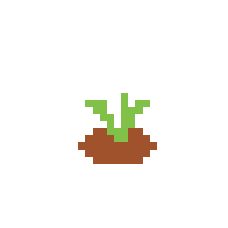
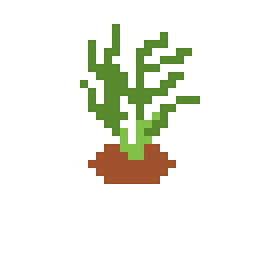

## 🎮 [Project Survival] 개발 일지 #6 - 에셋 하나 지웠다가 전부 무너진 날, 그리고 첫 수확 (Day 8~9)

날짜: 2025년 9월 30일 ~ 10월 1일

이번 편의 목표: 작물이 물을 받고 자라서 수확되는 **농사 사이클**을 완성한다. ...였는데, Day 8은 거의 통째로 내가 만든 사고를 수습하는 데 썼다.

---

### 📝 개발 내용 요약

**Day 8 - 에셋 삭제 사고와 연쇄 버그**
- 새싹 스프라이트(`spr_Sprout`)를 실수로 삭제했다. 이 스프라이트를 쓰던 프리팹과 기능이 줄줄이 고장 났다.
- 복구 방법을 순서대로 알아봤다: 휴지통 → 버전 관리(Git 등) → Unity의 Ctrl+Z
- 새 프리팹을 만들고 하나씩 다시 연결하면서 기능을 되살렸다.
- 덤으로, 스프라이트 색은 원본 Import Settings가 아니라 씬 오브젝트의 **Sprite Renderer → Color**에서 바꾼다는 것도 배웠다. 원본 하나로 여러 색의 오브젝트를 만들 수 있다.

**Day 9 - 성장과 수확**
- 물을 받은 작물이 일정 시간이 지나면 다음 단계 그림으로 바뀌는 성장 시스템을 만들었다.
- Piskel로 씨앗 → 새싹 → 다 자란 작물, 3단계 임시 스프라이트를 직접 그렸다.


*Piskel로 그린 1단계: 씨앗*



*2단계: 새싹*



*3단계: 다 자란 작물*

- 마지막 단계가 되면 '수확 가능' 상태가 되고, 클릭하면 아이템을 얻고 작물이 사라진다.

<video src="media/06/day09_grow_harvest.mp4" controls width="100%"></video>

*▶ Day 9: 물 주기 → 성장 → 수확까지 한 바퀴*

---

### 🛠️ 주요 구현 기능 및 코드

#### 1. 성장 로직 (Crop.cs)
- 물을 받은 상태(`isWatered`)일 때만 타이머가 흐른다.
- 타이머가 `timeToGrow`에 닿으면 `Grow()`로 단계를 올리고 스프라이트를 바꾼다. 다음 단계로 가려면 다시 물을 줘야 한다.

```csharp
void Update()
{
    if (isWatered && !isHarvestable)
    {
        growthTimer += Time.deltaTime;
        if (growthTimer >= timeToGrow)
        {
            Grow();
        }
    }
}

void Grow()
{
    currentGrowthStage++;
    growthTimer = 0f;
    isWatered = false;

    if (currentGrowthStage >= growthSprites.Length - 1)
    {
        isHarvestable = true;
    }
    UpdateSprite();
}
```

#### 2. 수확 (PlayerAction.cs)
- 클릭한 곳을 Raycast로 검사해서 `Crop`이면, `IsHarvestable()`일 때 수확하고 아니면 물을 준다.
- 수확하면 `dataManager.AddItem()`으로 아이템을 얻고 `Destroy(cropObject)`로 작물을 지운다.

---

### 🚨 마주친 문제 및 해결 과정

**1. 씨앗이 안 심어졌다 (Day 8)**
- 원인: 스크립트가 들고 있던 Sprout 프리팹의 스프라이트가 삭제되면서 참조가 깨졌다(Missing).
- 해결: 정상 스프라이트로 새 Sprout 프리팹을 만들고, 인스펙터의 비어 있는 프리팹 칸에 드래그 앤 드롭으로 다시 연결했다.

**2. 이번엔 물 주기가 안 됐다 (Day 8)**
- 원인: 새 프리팹에 예전 프리팹에 있던 설정이 빠져 있어서, 물 주기 스크립트가 '식물'로 알아보지 못했다.
- 해결:
  1. Collider가 붙어 있는지 확인했다.
  2. 대상을 구분하는 **Tag**("Plant")를 예전과 똑같이 설정했다.
  - `Debug.Log`로 "클릭했을 때 어떤 Tag가 잡히는지"를 찍어 보고 원인을 찾았다.

**3. 다른 스크립트의 private 변수에 접근 못 함 (Day 9)**
- 현상: `PlayerAction`이 `Crop`의 private 변수 `isWatered`를 직접 읽으려다 보호 수준 에러가 났다.
- 해결: `Crop`에 `public bool IsWatered()` 함수를 만들어서 그걸 통해서만 확인하게 했다. 캡슐화 원칙을 처음으로 "필요해서" 써 봤다.

---

### 💡 이번 편 회고
- Unity에서 스크립트와 에셋 사이의 **참조는 생명선**이다. 인스펙터의 `None` 칸 하나가 기능 전체를 멈출 수 있다.
- 그리고 그때 Git을 제대로 쓰고 있었다면 이 하루는 1분이면 끝났을 거다. (이건 1년 뒤의 나도 뼈저리게 공감한다.)
- Day 9로 드디어 **[경작 → 파종 → 물 주기 → 성장 → 수확]** 이 한 바퀴 돌았다.

### 🚀 다음 단계 목표
- [ ] 게임 안에 '시간'을 만들기: 시계가 흐르고, 낮과 밤이 바뀌게
