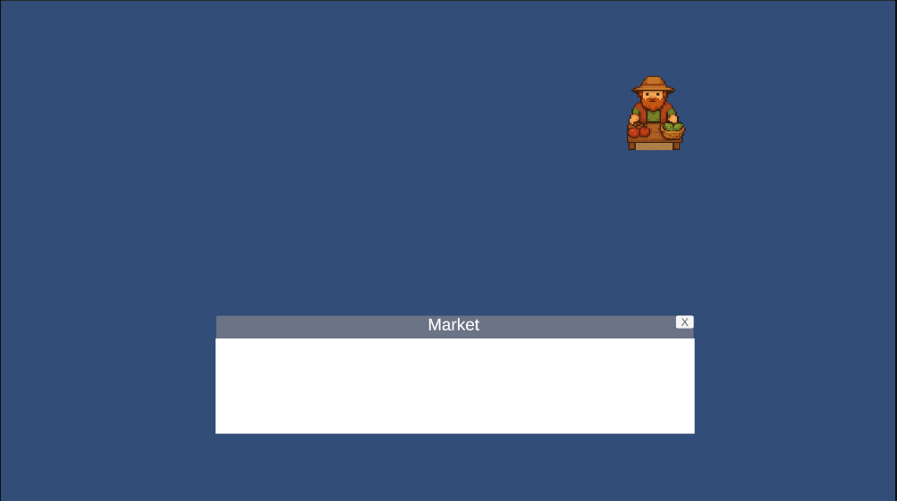
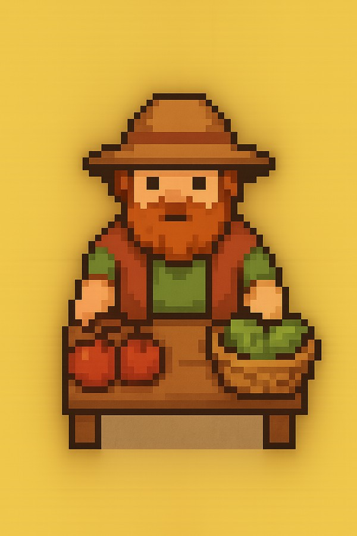

## 🎮 [Project Survival] 개발 일지 #8 - 상점을 열었더니 씬 전환 버그가 쏟아졌다 (Day 14~18)

날짜: 2025년 10월 3일 ~ 10월 7일

이번 편의 목표: 시장에 상인을 세우고, **[농사 → 수확 → 판매 → 구매]** 로 이어지는 경제 루프를 완성한다.

---

### 📝 개발 내용 요약

**Day 14 - 상점 UI 틀**
- Market 씬에 임시 상인(`Shopkeeper`, 사각형 스프라이트 + Box Collider 2D)을 세웠다.
- `ShopPanel`을 만들고 평소에는 꺼 두었다. 안에는 제목(`TitleText`), 닫기 버튼(`CloseButton`), 아이템이 정렬될 `ItemGrid`(Grid Layout Group)를 넣었다.



*Day 14: 상점 UI 기본 틀 (제목, 닫기 버튼, 아이템 그리드)*



*시장 상인 UI 그림*

**Day 15 - 말 걸기 (E키)**
- 상인에게 **콜라이더 두 개**를 붙였다.
  - 하나는 부딪히는 몸통용
  - 하나는 접근을 감지하는 더 넓은 Is Trigger 범위용
- `OnTriggerEnter2D` / `OnTriggerExit2D`로 범위 안에 있는지 추적하고, 범위 안에서 E를 누르면 `shopPanel.SetActive(!shopPanel.activeSelf)`로 열고 닫는다.

<video src="media/08/day15_shop_open.mp4" controls width="100%"></video>

*▶ Day 15: 상인 앞에서 E를 누르면 상점이 열리고 닫힌다*

**Day 16 - 아이템 표시 (그리고 대규모 디버깅)**
- 상점이 열릴 때 인벤토리를 읽어서 `ShopSlot` 프리팹을 동적으로 만들어 보여 주게 했다.
- 그런데 이 과정에서 씬 이동 관련 버그가 한꺼번에 터졌다. 이날은 거의 디버깅만 했다. (아래 문제 해결 참고)

<video src="media/08/day16_shop_items.mp4" controls width="100%"></video>

*▶ Day 16: 상점에 내 인벤토리 아이템이 표시된다*

**Day 17 - 판매**
- `ShopSlot.cs`가 자기 아이템 정보를 기억하고, 클릭되면 `SellItem()`을 실행한다.
- 버튼 이벤트는 `onClick.AddListener()`로 코드에서 연결했다.
- `DataManager`에 골드(`gold`, `AddGold()`, `goldText`)를 추가했다.

<video src="media/08/day17_sell.mp4" controls width="100%"></video>

*▶ Day 17: 아이템을 클릭하면 팔리고 골드가 오른다*

**Day 18 - 구매/판매 탭**
- 상점 안에 '구매' / '판매' 탭 버튼과 각각의 그리드(`BuyItemGrid`, `SellItemGrid`)를 만들었다.
- `UpdateShopUI(bool isBuyMode)`로 지금 탭에 맞는 목록을 그린다.
- `ShopSlot`에 `SetupForBuy()`와 `BuyItem()`을 추가했다. 골드가 충분하면 차감하고 아이템을 준다.

<video src="media/08/day18_buy_sell_tabs.mp4" controls width="100%"></video>

*▶ Day 18: 구매/판매 탭 전환*

---

### 🛠️ 주요 구현 기능 및 코드

#### 판매와 구매 (ShopSlot.cs)

```csharp
void SellItem()
{
    if (dataManager == null || shopManager == null) return;

    int price = ItemAssets.Instance.GetSellPriceByName(itemName); // (Day 25에 가격표 추가)
    dataManager.RemoveItem(itemName, 1);
    dataManager.AddGold(price);
    shopManager.UpdateShopUI(false); // 판매 탭 새로고침
}

void BuyItem()
{
    if (dataManager.gold >= itemPrice)
    {
        dataManager.AddGold(-itemPrice);
        dataManager.AddItem(itemName, 1);
    }
    else
    {
        Debug.Log("골드가 부족합니다!");
    }
}
```

#### 씬이 바뀔 때마다 참조 다시 찾기 (PlayerAction.cs, Day 16)

```csharp
void Awake()
{
    // ... 싱글턴 + DontDestroyOnLoad ...
    SceneManager.sceneLoaded += OnSceneLoaded;
}

void OnSceneLoaded(Scene scene, LoadSceneMode mode)
{
    GameObject gridObject = GameObject.Find("Grid");
    groundTilemap = gridObject != null ? gridObject.GetComponentInChildren<Tilemap>() : null;
}
```

---

### 🚨 마주친 문제 및 해결 과정

**1. DontDestroyOnLoad 매니저들이 '죽은' 오브젝트를 붙잡고 있었다 (Day 16)**
- 현상: 씬을 오가면 MissingReferenceException이 쏟아졌다.
- 원인: `PlayerAction`, `DataManager`, `LightingManager`는 씬이 바뀌어도 살아남는데, 이들이 기억하는 타일맵, UI, 조명은 **이전 씬과 함께 파괴된 것들**이었다.
- 해결: 세 매니저 모두에 `SceneManager.sceneLoaded` 이벤트를 달아서, 씬이 열릴 때마다 필요한 것을 **새로 찾게** 했다.
  - PlayerAction → 그 씬의 Tilemap
  - DataManager → `FindUIElements()`로 UI 전체
  - LightingManager → 그 씬의 조명과 카메라

**2. ShopSlot을 못 찾는다 (Day 17)**
- 원인: `ShopSlot` 프리팹에 `ShopSlot.cs` 컴포넌트가 붙어 있지 않았다. 복제는 되는데 그 안에 스크립트가 없었다.
- 해결: Project 창에서 프리팹 원본을 선택해 Add Component.

**3. "아이템 스프라이트를 찾을 수 없음: Stone" 경고 (Day 17)**
- 원인: 아이템 이름과 그림을 짝지어 두는 `ItemAssets`에 Stone이 등록되어 있지 않았다.
- 해결: `stoneSprite` 변수와 `case "Stone":`을 추가하고 인스펙터에서 그림을 연결했다.

**4. 판매 탭 슬롯이 클릭되지 않음 (Day 18)**
- 원인: 배경 역할인 `ItemGrid`, `ShopPanel`의 Image에 **Raycast Target**이 켜져 있어서, 버튼보다 먼저 클릭을 가로챘다.
- 해결: 배경 이미지들의 Raycast Target을 끔.

**5. 팔아도 개수가 줄지 않음 (Day 18)**
- 원인: `SellItem()` 마지막에 화면 새로고침 호출이 빠져 있었다.
- 해결: `shopManager.UpdateShopUI(false);` 추가.

**6. 시장에 가면 상단 UI(나무, 돌, 골드, 상태 바)가 안 보임 (Day 18)**
- 원인: DataManager는 살아남지만 UI는 씬마다 따로다. Market 씬의 Canvas에는 그 UI 오브젝트가 아예 없었다.
- 해결: Farm 씬 Canvas의 공용 UI를 복사해서 Market 씬에 붙여 넣어 구조를 맞췄다.
  - (지금 생각하면 공용 UI를 하나로 만들어 같이 넘기는 게 맞았다. 이 복붙이 나중에 또 발목을 잡는다.)

---

### 💡 이번 편 회고
- 드디어 **[농사 → 수확 → 판매]** 경제 루프가 돌았다. 처음으로 "내가 키운 당근으로 돈을 벌었다."
- 이번 편의 진짜 수확은 상점이 아니라 **DontDestroyOnLoad 객체가 씬 종속 오브젝트를 다루는 법**을 배운 것이다. 살아남는 쪽이 "죽는 쪽"을 기억하면 안 된다.

### 🚀 다음 단계 목표
- [ ] 집(Home) 씬과 잠자기: 하루를 끝내고 다음 날로 넘어가기
- [ ] 보관함, 핫바
