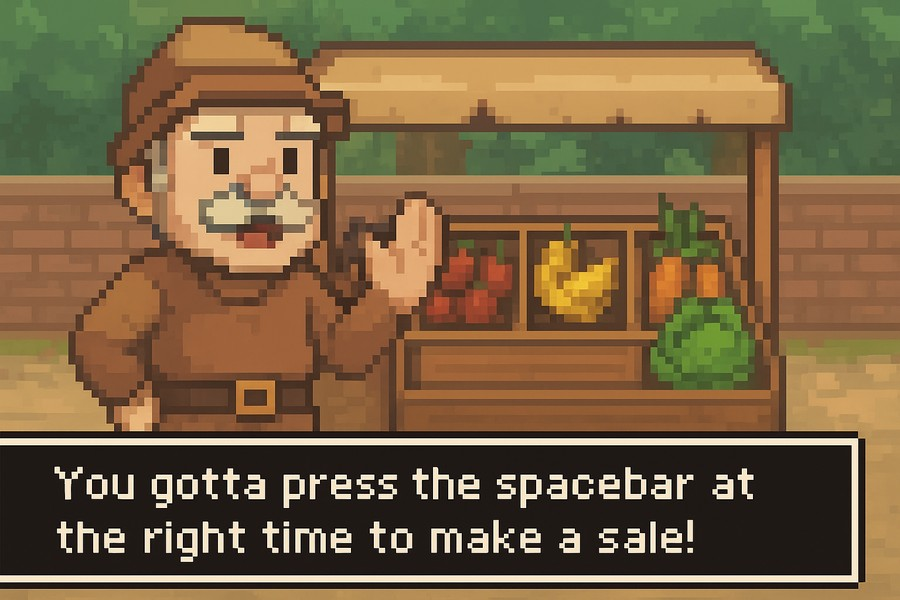

## 🎮 [Project Survival] 개발 일지 #11 - 흥정 미니게임, 농장 꾸미기, 우물 (Day 28~30)

날짜: 2025년 10월 11일 ~ 10월 13일

이번 편의 목표: 농사 말고도 골드를 버는 **흥정 미니게임**을 만들고, 단색이던 농장을 진짜 농장처럼 꾸미고, 생존 수치 중 마지막으로 남은 **갈증**을 해결할 방법을 만든다.

---

### 📝 개발 내용 요약

**Day 28 - 흥정 미니게임**

- 농장의 흥정꾼 NPC(`HagglerNPC`)에 `Portal`을 달아 `MiniGame` 씬으로 들어가게 했다.
- 화면에는 왕복하는 막대(`Slider`), 성공 구간(`Image`), 결과 글자(TextMeshPro)가 있다.
- 스페이스를 누른 순간 막대가 성공 구간 안이면 +50 골드, 아니면 실패.
- 끝나면 `Invoke`로 2초 뒤 농장으로 돌아간다.

<video src="media/11/day28_haggle.mp4" controls width="100%"></video>

*▶ Day 28: 흥정 미니게임. 막대가 초록 구간에 있을 때 스페이스!*



*Day 28 노트에 "이걸로 바꾸자"며 붙여 둔 새 흥정 배경 시안*

**Day 29 - 아트 폴리싱과 시스템 안정화**

- 농장 배경을 타일맵 아트로 바꿨다.
- 배경이 항상 맨 뒤에 그려지도록 **Sorting Layer**에 `Background`를 만들어 가장 위(가장 먼저 그려지는 곳)에 두었다.
- 밭 영역을 Tile Palette로 넓혔다.
- 씬 전환 버그를 다시 한번 전면 점검했다. (아래 문제 해결 참고)

**Day 30 - 갈증 해소와 날짜 표시**

- 농장에 우물(`Well.cs`)을 두고, **물뿌리개를 든 채** 우물 앞에서 E를 누르면 `RefillThirst()`로 갈증이 가득 찬다.
- 시간 옆에 날짜(`DayText`)도 보이게 `UIManager`를 고쳤다.
- 이로써 허기(음식)와 갈증(우물) 모두 플레이어가 직접 해결할 수단이 생겼다.

<video src="media/11/day30_well.mp4" controls width="100%"></video>

*▶ Day 29~30: 타일맵으로 꾸민 농장, 우물에서 갈증 채우기, 날짜 표시*

---

### 🛠️ 주요 구현 기능 및 코드

#### 흥정 미니게임 (HaggleGame.cs)

```csharp
void Update()
{
    if (!isGameActive) return;

    // 막대 왕복
    if (movingRight)
    {
        haggleSlider.value += barSpeed * Time.deltaTime;
        if (haggleSlider.value >= 1) movingRight = false;
    }
    else
    {
        haggleSlider.value -= barSpeed * Time.deltaTime;
        if (haggleSlider.value <= 0) movingRight = true;
    }

    if (Input.GetKeyDown(KeyCode.Space)) CheckResult();
}

void CheckResult()
{
    isGameActive = false;
    float result = haggleSlider.value;

    if (result >= successZoneStart && result <= successZoneEnd)
    {
        resultText.text = "Great Success! +50 Gold";
        DataManager.instance.AddGold(50);
    }
    else
    {
        resultText.text = "Haggle Failed...";
    }

    Invoke("ReturnToFarm", 2f);
}
```

---

### 🚨 마주친 문제 및 해결 과정

**1. 씬을 다녀오면 기능이 하나씩 고장 남 (Day 29)**

- 현상: 시장이나 집에 다녀오면 땅이 안 갈리거나, 집에서 클릭하면 게임이 멈췄다.
- 원인: Day 16에서 겪은 것과 같은 뿌리였다. 살아남는 매니저(`PlayerAction`, `DataManager`, `LightingManager`)가 새 씬의 카메라, UI, 타일맵을 모른다.
- 해결: 핵심 매니저 모두가 `SceneManager.sceneLoaded`에서 **필요한 컴포넌트를 스스로 다시 찾도록** 다시 점검하고 통일했다.

**2. 새로 그린 밭이 안 갈림 (Day 29)**

- 원인: 스크립트에 연결된 흙 타일 에셋과, 팔레트로 새로 칠한 흙 타일이 **서로 다른 에셋**이었다. 눈으로는 똑같아 보였다.
- 해결: 모든 흙을 스크립트가 아는 타일 에셋 하나로 다시 칠했다. (Day 6과 같은 종류의 실수. 두 번 겪으니 확실히 기억된다.)

---

### 💡 이번 편 회고

- 미니게임은 `Slider`, `Time.deltaTime`, `Invoke`만으로도 꽤 그럴듯하게 만들 수 있었다.
- 다만 지금 보면 문제가 있다. **흥정을 무한히 반복하면 골드가 무한히 나온다.** 농사보다 미니게임이 돈이 되는 구조다. (시즌 2에서 하루 1회 + 시장 가격 보너스로 바꾼다.)
- Day 28 페이지 끝에 "이걸로 바꾸자"며 새 흥정 배경 이미지를 붙여 뒀는데, 그 그림은 결국 1년 뒤에 바뀌었다.

### 🚀 다음 단계 목표

- [ ] 마감 전 안정화: 남은 버그 정리, 체력이 0이 되면 게임 오버
- [ ] 인트로 스토리, BGM, 빌드
