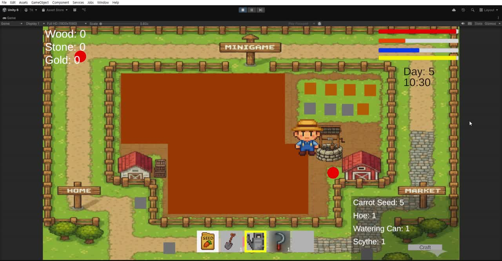
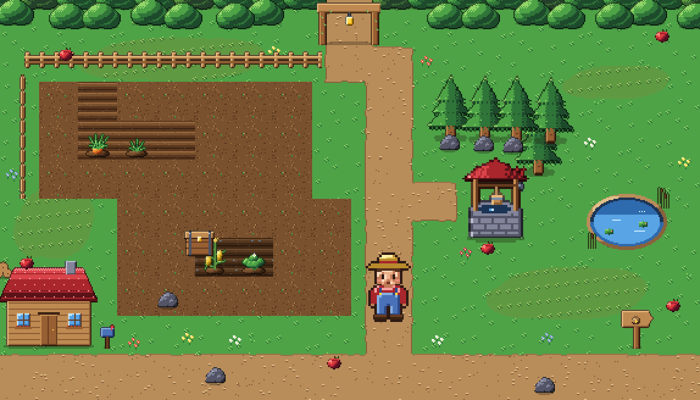

## 🌱 [My Little Farmstead] 개발 일지 #13 - 1년 만에 다시 연 프로젝트: "또 하나의 스타듀밸리"가 되지 않으려면 [시즌 2 시작]

날짜: 2026년 11월

시즌 1(Day 1~33)에서 만든 게임은 돌아가긴 했다. 하지만 1년 만에 다시 열어 보니 솔직히 이랬다.
- 플레이해 보면 **스타듀밸리의 축소판**이었다. 개발 일지에도 "스타듀밸리의 핵심 재미를..."이라는 문장이 몇 번이나 나온다.
- 무슨 씨앗을 심어도 당근이 나왔다.
- 흥정을 반복하면 골드가 무한히 나왔다.



*시즌 1이 끝났을 때(2025년 10월)의 농장*

그래서 시즌 2의 목표를 세 가지로 잡았다.
1. **스타듀밸리와 다른 게임**이 될 것. 새 기능을 만들 때마다 "이거 스타듀랑 비슷한가?"를 먼저 확인한다.
2. **팔 수 있는 게임**이 될 것. 목표는 Steam 유료 출시 + 무료 데모.
3. 임시 그림을 걷어 내고 **손맛 있는 픽셀 아트**로 바꿀 것.

프로젝트 이름도 `Project Survival`에서 **My Little Farmstead**로 바꿨다.



*시즌 2에서 다시 그린 농장(2026년 11월). 이 차이를 만든 과정이 이번 시즌 이야기다*

---

### 📝 1. 컨셉 다시 쓰기: "회색 도시에서 온 사람이 세상의 색을 되찾는 농장 게임"

시즌 1 인트로에 이미 이런 문장이 있었다.

> *"Day after day in the gray city felt endless… can I build my happiness again?"*

이 문장을 장식이 아니라 **게임 시스템의 중심**으로 올렸다.

| 비슷한 게임 | 그 장르의 흔한 문제 | 이 게임의 답 |
|---|---|---|
| 스타듀밸리 | 에너지와 시간을 최대한 짜내는 플레이가 최적 → 게임 속에서도 번아웃 | **쉬는 것이 최적 전략**인 시스템 |
| 목장이야기 | 성장 지표 = 돈과 규모 | 성장 지표 = **마음(행복)** 과 세상의 색 |
| 코지 농장 게임들 | "또 하나의 스타듀"처럼 보이기 쉬움 | **회색 → 컬러**로 바뀌는, 한눈에 보이는 장면 |

#### 마음(Heart) 시스템
마음은 0~100(시작 20)이고, **잠들 때 하루를 평가**해서 오르내린다.

| 오늘의 생활 | 마음 |
|---|---|
| 자정 전에 잠들기 | +4 |
| 밥을 먹었다 | +3 |
| 에너지를 바닥까지 쓰지 않았다 | +3 |
| 에너지를 바닥까지 썼다 (과로) | −3 |
| 새벽 2시까지 버티다 기절 | −8 (골드 10% 분실) |

<video src="media/13/winter_start.mp4" controls width="100%"></video>

*▶ 새 게임은 회색 겨울 농장에서 시작한다. 동쪽에는 치워야 할 묵은 밭이 있다*

마음이 낮으면(번아웃) 최대 에너지가 60%까지 줄고, 세상도 거의 회색이다. 무리하면 내일의 내가 약해진다.

```csharp
// 마음이 낮을수록 하루에 할 수 있는 일이 적다 (60% ~ 100%)
public float MaxEnergyNow => maxEnergy * (0.6f + 0.4f * Mathf.Clamp01(heart / maxHeart)) * ...;
```

---

### 🛠️ 2. 시즌 1의 숙제부터 갚기 (버그 20개)

새 기능보다 먼저, 시즌 1이 남긴 문제를 고쳤다. 대표적인 것만 적으면:

| 문제 | 해결 |
|---|---|
| 무엇을 심든 당근이 나옴 (Day 27 롤백의 그 문제) | 작물 데이터를 `CropDB`로 분리 |
| 딸기, 옥수수, 감자 씨앗이 핫바에 안 보임 | 아이템 분류를 `ItemDB` 하나로 관리 |
| 씬을 다녀오면 갈아 둔 땅, 물 준 땅이 초기화 | 밭 전체 상태를 `FarmData`로 보관 |
| 작물이 실시간 15초마다 자람 | **물을 준 날 수** 기준으로 성장 |
| 흥정으로 골드 무한 | 하루 1회, 대신 그날 시장 판매가 +25~50% |
| 하루가 약 27초 | 하루(06:00~02:00) ≈ 10분 |
| 배고픔이 100초 만에 0 | 게임 시간 기준으로 감소 |
| 게임 오버 후 RESTART → 체력 0이라 바로 또 게임 오버 | 마지막 아침 저장에서 재시작 |
| 한글 주석이 깨짐 (CP949) | UTF-8로 통일 |

그리고 **세이브/로드**(`save.json`)를 넣었다. 시즌 1에는 게임을 끄면 모든 게 사라졌다.

---

### 🚨 3. 이번에 세운 작업 규칙

1. **씬 파일은 최대한 건드리지 않는다.** 새 UI, 주민, 지역은 실행할 때 코드로 만든다. 씬 파일을 고치다 참조가 깨지는 일을 시즌 1에서 너무 많이 겪었다.
2. **Unity 없이도 검사한다.** Unity API 흉내(stub)를 만들어 두고 C# 컴파일을 미리 돌린다. 규칙만 담은 클래스(예: `ForestState`, `LakeState`)는 Unity 없이 테스트한다.
3. **계획 먼저, 구현은 그다음.** 계획마다 "스타듀밸리와 비슷한 점"을 같이 적고, 비슷하면 바꾼다.

---

### 💡 이번 편 회고
- 1년 전의 나는 "기능을 하나 더"에 집중했다. 지금은 **"이 게임만의 이유가 뭐지?"** 를 먼저 묻는다.
- 마음 시스템은 메시지(번아웃 회복)와 규칙이 같은 방향을 본다는 점이 마음에 든다. 설교하지 않고, 플레이로 느끼게 한다.

### 🚀 다음 단계 목표
- [ ] 임시 그림을 전부 통일된 픽셀 아트로 바꾸기
- [ ] 마을 주민도 회색으로: 소원을 들어주면 색이 돌아오게
