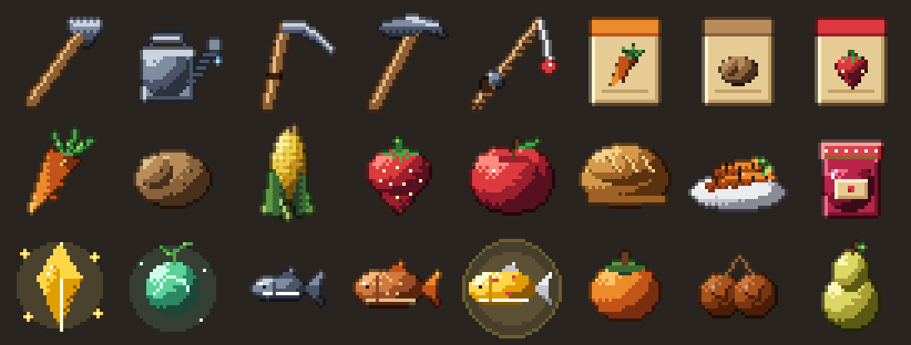
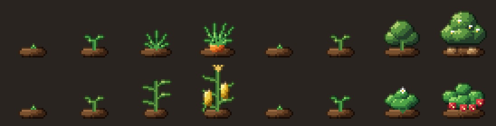
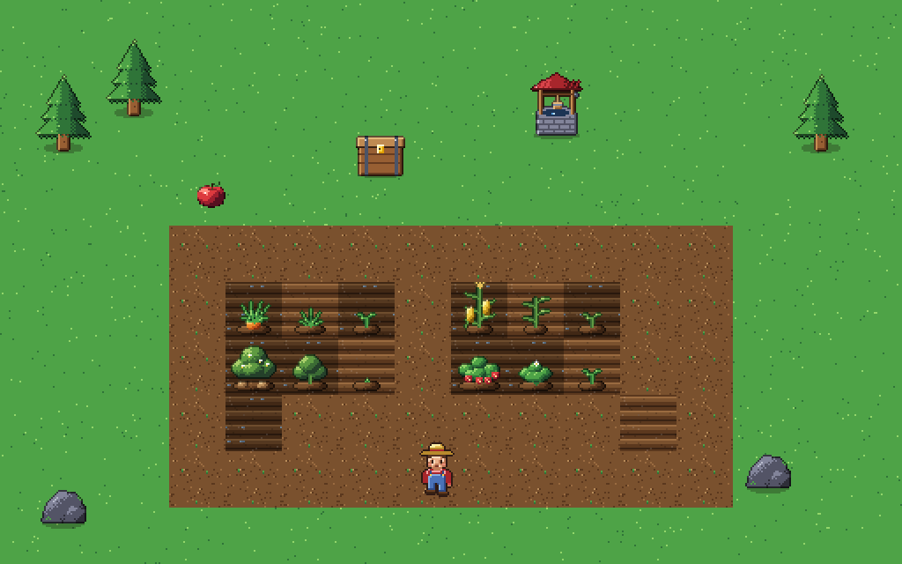
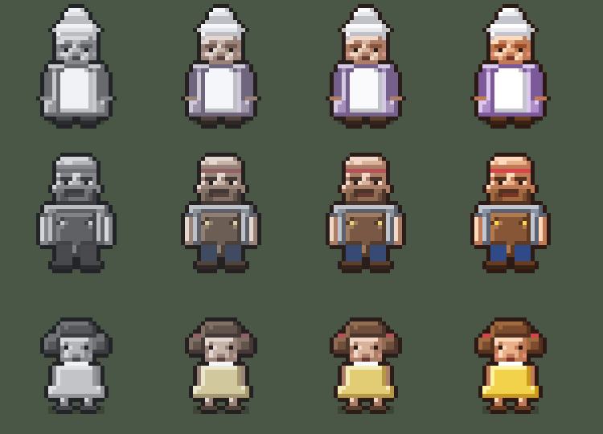
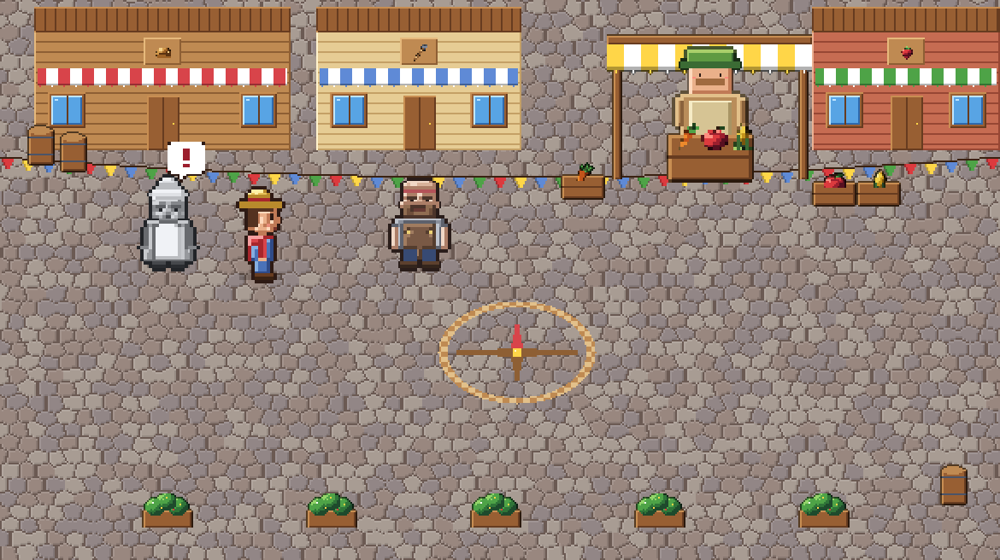
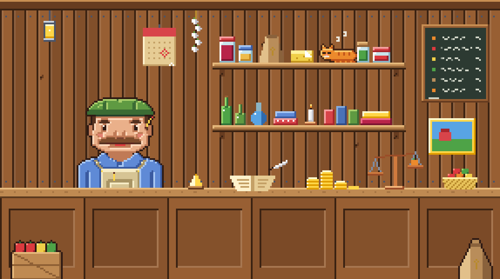
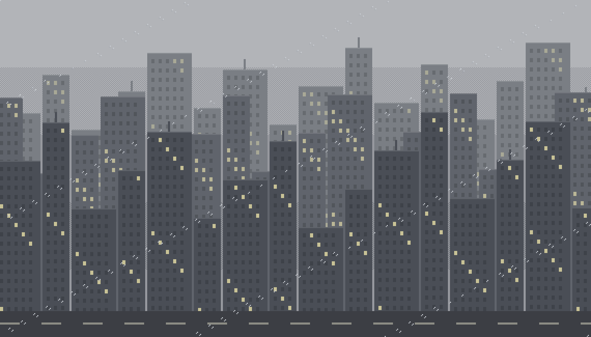

## 🌱 [My Little Farmstead] 개발 일지 #14 - 그림을 전부 다시 그리고, 회색 주민을 만나다

날짜: 2026년 11월

이번 편의 목표: Piskel로 급하게 그린 임시 그림을 **하나의 스타일로 통일된 픽셀 아트**로 바꾸고, 마을에 **회색 주민** 세 명을 들인다.

---

### 📝 1. 픽셀 아트 전면 교체

조건은 하나였다. **"찍어 낸 것 같은 그림은 안 된다."** 흐릿한 경계, 의미 없는 디테일, 픽셀 크기가 들쭉날쭉한 그림은 다 빼기로 했다.

그래서 그림을 **Python 스크립트로 한 픽셀씩 찍어서** 만든다 (`Tools/pixelart`).

- 모든 그림이 **같은 팔레트**를 쓴다. 색마다 어두운 색 → 밝은 색 4단계(ramp)를 정해 두었다.
- 광원은 항상 **왼쪽 위**, 외곽선은 자동으로 한 겹.
- 기준 크기는 **32×32 픽셀 = 한 칸**. 캐릭터, 나무, 우물 모두 배경과 같은 픽셀 크기로 그린다. (처음엔 캐릭터를 2배로 그렸다가, 미리보기에서 어색해서 다시 맞췄다.)
- 사람은 한 줄 한 줄 손으로 픽셀 지도를 적는다.

```python
def rosa():
    """Grandma Rosa, the baker: white bun, glasses, lavender dress, white apron."""
    ...
    m = PixelMap(W, H)
    m.seg(0, 8, 9, 'w'); m.seg(1, 7, 9, 'w'); m.seg(2, 7, 9, 'w')  # bun
```



*새로 그린 아이템 아이콘 일부 (32×32, 4배 확대)*



*작물 성장 4단계: 당근, 감자, 옥수수, 딸기*


*플레이어 걷기 프레임: 아래, 옆, 위 × 3*

| 분류 | 개수 |
|---|---|
| 아이템 아이콘 | 24 (도구, 씨앗 봉투, 작물, 음식, 정수 등) |
| 작물 성장 단계 | 4종 × 4단계 |
| 땅 타일 | 흙, 갈린 흙(둥근 이랑), 젖은 흙 |
| 플레이어 | 3방향 × 걷기 3프레임 |
| 배경 | 농장, 집, 시장, 흥정, 인트로 도시 |

**씬 파일은 고치지 않았다.** `PixelArtWorld`가 씬이 열릴 때 원래 그림을 숨기고, 같은 자리에 픽셀 아트를 겹쳐 그린다. 콜라이더와 스크립트는 그대로다.
---



*바꾼 그림으로 맞춰 본 게임 화면*


### 📝 2. 회색 주민 세 명

주인공처럼 마을 사람들도 색을 잃었다. **소원을 하나 들어줄 때마다 색이 1/3씩** 돌아온다.

| 주민 | 첫 소원 → 보상 |
|---|---|
| **로사 할머니** (빵집) | 당근 3 → 빵 + 당근 케이크 레시피 |
| **테오** (대장장이) | 나무 10 → 구리 물뿌리개 레시피 |
| **미나** (아이) | 사과 2 → 낚싯대 (낚시 해금) |

- 머리 위에 `!`가 뜨면 할 이야기가 있거나 소원 아이템을 가지고 있다는 뜻이다.
- 주민 정보(대사, 소원, 보상)는 `VillagerDB.cs` 한 곳에 모았다. 새 주민은 여기에 한 명 추가하고 그림만 그리면 된다.
- 주민은 `WorldSpawner.cs`가 실행 중에 배치한다. 역시 씬 수정 없음.


*소원을 들어줄 때마다 회색 → 컬러로 (로사, 테오, 미나)*



*시장에 선 회색 주민들*


### 📝 3. 그 밖에 새로 들어간 것

- **낚시**: 연못에서 E → `!!`가 뜨면 바로 E. 피라미, 잉어, 드물게 황금 잉어.
- **도시에서 온 편지**: 4일째, 10일째 아침에 옛 상사가 야근 제안을 보낸다. 수락하면 골드는 많이 주지만 마음이 크게 깎인다. 거절하면 마음이 오른다.
- **생활 일지 (J)**: 마음, 주민별 진행도, 물고기 도감.
- **흥정 장면 다시 그리기**: Day 28에 "이걸로 바꾸자"고 적어 뒀던 흥정 장면을, 1년 만에 진짜로 바꿨다.



*다시 그린 흥정 장면*



*인트로의 회색 도시*

---

### 🚨 마주친 문제 및 해결 과정

**1. 캐릭터가 밭 두 칸만큼 컸다**

- 원인: 원래 씬의 그림 크기에 맞춰 픽셀 아트를 늘려 그렸다. 그래서 캐릭터 픽셀이 배경 픽셀의 2배였다.
- 해결: 모든 그림을 **배경과 같은 픽셀 크기(32px = 1유닛)** 로 그리게 바꿨다. 픽셀 크기가 섞이면 그게 바로 "어색한 그림"이 된다.

**2. 밭 칸이 구분되지 않았다**

- 해결: 갈린 흙 타일을 칸마다 **둥근 이랑**으로 다시 그리고, 밭 둘레에 흙 테두리를 그렸다.

---

### 💡 이번 편 회고

- 그림을 코드로 찍으니 **수정이 쉽다.** 색 하나를 바꾸면 모든 그림에 같이 반영된다.
- 주민이 회색 → 컬러로 바뀌는 순간이 이 게임의 "보상 장면"이 됐다. 스크린샷 한 장으로 설명이 끝나는 장면을 하나 더 얻었다.

### 🚀 다음 단계 목표

- [ ] 마음이 계절을 정하는 시스템
- [ ] 따라다니는 정령, 나눔
