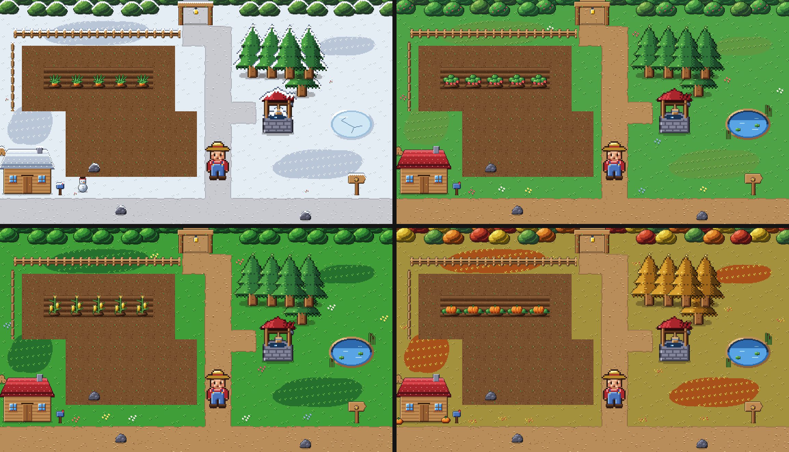
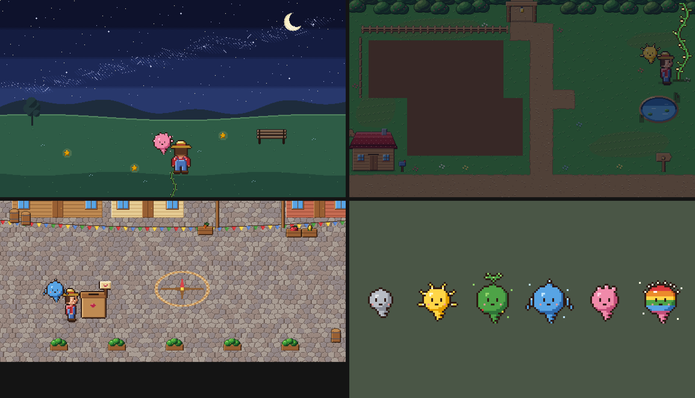
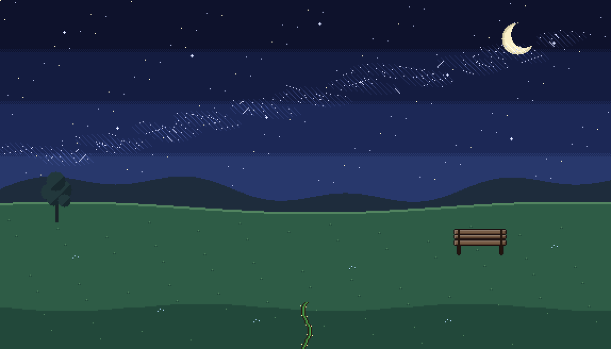

## 🌱 [My Little Farmstead] 개발 일지 #15 - 달력이 아니라 마음이 계절을 정한다 (+ 정령, 나눔, 앨범, 데모)

날짜: 2026년 11월

이번 편의 목표: 이 게임만의 계절 시스템을 만들고, 오래 붙잡아 둘 **수집 요소**(정령, 앨범)와 **출시 준비**(데모 모드)를 넣는다.

---

### 📝 1. 마음의 계절

대부분의 농장 게임은 28일마다 계절이 바뀐다. 이 게임은 **마음이 계절을 정한다.** 그리고 게임은 **겨울(번아웃)** 에서 시작한다.

| 마음 | 계절 | 새로 심을 수 있는 작물 |
|---|---|---|
| 0~29 | 겨울 | 당근, 감자 |
| 30~59 | 봄 | 딸기 |
| 60~84 | 여름 | 옥수수, 해바라기 |
| 85~ | 가을 | 호박 |

- 계절은 **아침에만** 바뀐다. 바뀌면 큰 안내 화면이 뜨고 농장과 시장 배경이 그 계절 그림으로 바뀐다.
- **꽃샘추위**: 다시 무리해서 기준보다 마음이 5 넘게 떨어지면 한 계절 돌아간다.
- 계절이 돌아가도 **작물은 시들지 않는다.** 멈출 뿐이다. 벌보다 보상 위주로 가자는 원칙.
- **날씨도 마음을 따른다.** 전날 마음이 많이 올랐으면 비 확률이 절반, 마음이 줄었으면 비가 더 잦다. 겨울엔 눈이 온다.

<video src="media/15/spring_comes.mp4" controls width="100%"></video>

*▶ 마음이 30을 넘긴 다음 날 아침, 겨울 농장에 봄이 온다*



*마음의 계절: 겨울 → 봄 → 여름 → 가을*


```csharp
// 올라갈 땐 기준을 넘기면 바로, 내려갈 땐 기준보다 5 넘게 떨어져야 (깜빡임 방지)
public static Season Evaluate(float heart, Season current, Season cap = Season.Autumn)
{
    Season target = ForHeart(heart);
    if (target > cap) target = cap;
    if (target > current) return target;
    if (target < current)
    {
        int idx = (int)current;
        if (heart < Thresholds[idx] - ColdSnapMargin) return (Season)(idx - 1);
    }
    return current;
}
```
---

### 📝 2. 색을 먹는 정령
- 처음으로 햇살의 파편이나 대지의 숨결을 얻으면 **회색 아기 정령**이 나타나 따라다닌다. (시즌 1 Day 5의 '자연의 메아리'가 여기서 다시 쓰인다.)
- G 키로 들고 있는 것을 먹인다. 햇빛, 대지, 물, 꽃 네 가지 색 기운이 쌓이고, 가장 많이 먹은 색으로 자란다.
- 네 색을 고르게 먹이면 희귀한 **프리즘 정령**이 된다. 모습은 10가지이고 일지에 기록된다.

### 📝 3. 나눔 → 별의 언덕
- 시장에 **나눔 상자**가 생겼다. 작물이나 음식을 나누면 나눔 점수가 쌓인다.
  - 단, **하루 최대 5점.** 비싼 걸 몰아넣어 하루 만에 끝내는 걸 막았다.
- 60점이 되면, 맑은 밤에 농장 구석에 빛나는 덩굴이 자란다. 올라가면 **별의 언덕**: 별 조각을 줍고, 벤치에서 별을 본다.
- 언덕은 새 씬이 아니라 **Farm 씬 안 아주 먼 곳**에 코드로 만들고, 카메라만 옮긴다. 씬 전환 버그를 다시 겪고 싶지 않았다.

> 정령 키우기와 나눔 점수는 '시장놀이'(조이월드)의 "새끼 용 키우기", "선행 점수 → 하늘나라" 구조에서 아이디어를 얻었다. 이름, 캐릭터, 그림은 가져오지 않고 구조만 이 게임의 주제(색, 마음)에 맞게 바꿨다.


*색을 먹는 정령과 별의 언덕*



*별의 언덕*


### 📝 4. 계절 앨범 (P)과 내일 예고
- 계절마다 사진 6장, 총 24장. 조건(첫 당근 수확, 처음 낚은 물고기, 황금 잉어...)을 이루면 회색 실루엣이 컬러 사진이 된다.
- 지나간 계절 사진도 나중에 찍을 수 있다. **놓쳐서 아쉬운 일은 없게** 했다.
- 아침 요약 화면 맨 아래에 **"Today"** 줄이 붙는다. "물을 주면 내일 익을 작물 3개", "봄까지 마음 6" 같은 식으로, 오늘 할 이유를 하나씩 준다.

### 📝 5. 데모 모드
- 체크 하나(또는 `DEMO_BUILD` 심볼)로 켠다.
- 마음이 **봄 기준(30)** 에 닿는 아침에 "봄이 오고 있어요... 데모를 플레이해 주셔서 감사합니다" 화면이 뜨고, Enter를 누르면 Steam 페이지가 열린다.
- 겨울(번아웃)에서 봄(회복)으로 넘어가는 순간에 데모가 끝난다. 이야기상으로도 "이제 막 나아지기 시작했는데"에서 끊기게 했다.

### 📝 6. 브라우저 미리보기
- Unity를 켜지 않아도 확인할 수 있게, 같은 그림과 규칙을 자바스크립트로 옮긴 웹 미리보기를 만들었다 (`Tools/webpreview`).
- "마음 +10", "하루 넘기기" 같은 버튼으로 계절 변화를 몇 초 만에 확인할 수 있다. 캐릭터 크기, 밭 모양 같은 피드백도 대부분 여기서 나왔다.

---

### 🚨 마주친 문제 및 해결 과정

**1. 별의 언덕이 너무 빨리 열렸다**
- 원인: 처음 규칙에서는 비싼 작물을 한꺼번에 나누면 하루 이틀 만에 점수가 찼다.
- 해결: 하루 최대 5점 + 60점 기준. 가장 빨라도 12일(주민 소원을 다 들어줘도 7일), 보통 15~20일째쯤 열린다.

**2. 상한에 닿았는데 아이템만 사라짐**
- 해결: 그날 상한에 닿으면 상자가 아이템을 **받지 않는다** ("내일 또 와 주세요"). 점수 없이 아이템만 잃는 일이 없게.

---

### 💡 이번 편 회고
- "마음이 계절을 정한다"는 이 게임에서 가장 마음에 드는 규칙이다. 플레이어가 잘 쉬면 봄이 빨리 온다.
- 수집 요소(정령 10종, 사진 24장)는 오래 붙잡아 두는 장치지만, **놓쳐도 벌이 없게** 만드는 데 신경 썼다. 코지 게임에서 놓침 스트레스는 독이다.

### 🚀 다음 단계 목표
- [ ] 맵 넓히기: 한 화면짜리 농장을 4배로, 그리고 계절마다 새 지역
