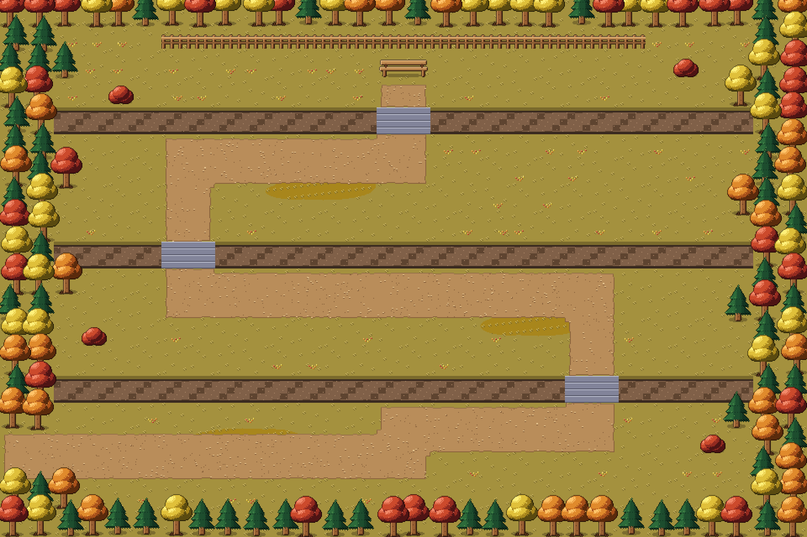
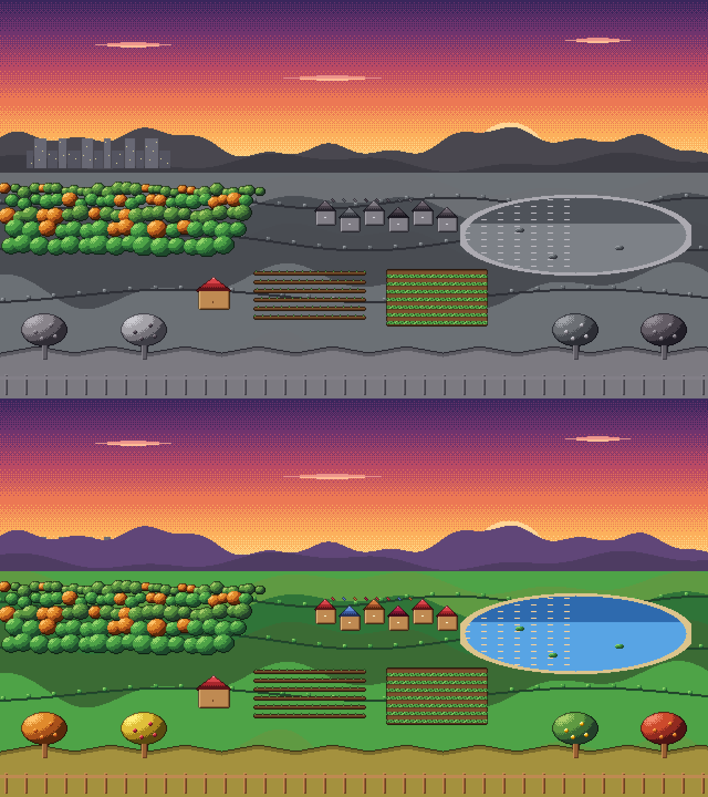

## 🌱 [My Little Farmstead] 개발 일지 #17 - 노을 언덕, 엔딩 "마지막 색은 나", 그리고 Unity에서 처음 켜 본 날

날짜: 2026년 11월

이번 편의 목표: 가을 지역 **노을 언덕**과 **엔딩**을 만든다. 그리고 시즌 2에서 만든 것들을 처음으로 내 컴퓨터의 Unity에서 직접 켜 보고, 나온 문제를 고친다.

---

### 📝 1. 가을: 노을 언덕

마음이 **85(가을)** 가 된 다음 아침, 남쪽 언덕길의 가시덤불이 **단풍 아치**로 바뀐다.

**과수원**

- 늙은 과일나무 6그루(사과 2, **배** 2, **감** 2)가 회색으로 서 있다.
- 낫으로 **가지치기** → **대지의 숨결**을 주면 되살아나고 그 둘레에 색이 돌아온다.
- 되살아난 나무는 3일마다 열매가 열린다.

**곶감**

- 곶감 걸이에 감을 걸어 두면 3일 뒤 곶감이 된다. 260G에, 먹으면 마음 +3.
- 배, 감, 곶감은 스타듀밸리에 없는 것들이라 일부러 골랐다.

**전망대**

- 꼭대기 벤치에 앉으면 노을 진 마을 풍경이 나온다.
- 하늘은 늘 컬러, 땅은 회색이다. 그리고 **내가 되살린 곳만 컬러로 덧그려진다.**



*노을 언덕*

<video src="media/17/overlook.mp4" controls width="100%"></video>

*▶ 전망대 벤치에 앉으면 노을 진 마을이 보인다. 이 영상은 숲과 호수만 되살린 상태*


| 그림 층 | 컬러가 되는 조건 |
|---|---|
| 묵은 밭 | 75% 이상 치움 |
| 숲 | 큰 나무가 깨어남 |
| 호수 | 다 맑아짐 |
| 마을 | 주민 3명 모두 색 회복 |
| 과수원 | 6그루 모두 되살림 |
| 내 집 | 엔딩을 봄 |

- 지평선의 도시는 **끝까지 회색**이다.
- 지금까지 한 일이 한 장의 풍경으로 보인다. 이 게임의 "진행도 화면"이자, 트레일러에 넣고 싶은 장면이다.
---



*전망대 풍경: 일부만 되살렸을 때(위)와 전부 되살렸을 때(아래)*


### 📝 2. 엔딩 A: "마지막 색은 나"

처음에는 "높은 곳에 올라가 되살린 마을을 내려다보는" 엔딩도 후보였는데, 스타듀밸리의 산꼭대기 엔딩과 겹쳤다. 그래서 내려다보는 장면은 전망대(진행도 화면)로 돌리고, 엔딩은 다른 방향으로 잡았다.

- 엔딩 전까지 **내 집만 회색**이다. 마을과 숲과 호수가 컬러가 될수록 회색 집이 더 눈에 띈다.
- 조건: 주민 3명 모두 색 회복 + 마음 90 이상 → 집에서 아침을 맞으면 시작된다.
- 도시에서 마지막 편지가 온다. "답장을 쓸까?"
  - **"I'm staying. This is home now."** 를 고르면 집 안에 색이 돌아오고, **"The last color was yours"** 가 나온다.
  - "Not yet"을 고르면 다음 날 다시 묻는다.

<video src="media/17/ending.mp4" controls width="100%"></video>

*▶ 엔딩: 마지막 편지에 "I'm staying"이라고 답하면 회색 집에 색이 돌아온다*


세상의 색을 다 되찾은 뒤 마지막으로 돌아오는 색이 **나 자신**이라는 게, 이 게임이 하고 싶었던 말이다.

### 📝 3. 개발용 단축키
엔딩까지 확인하려면 몇십 일을 플레이해야 해서, 에디터와 개발 빌드에서만 동작하는 단축키를 만들었다 (`DevKeys.cs`). 출시 빌드에서는 꺼진다.

- F1: 다음 계절로 (숲/호수/언덕이 열림)
- F3: 하루 넘기기
- F4: 테스트 아이템
- F6: 농장 → 숲 → 호수 → 언덕 순간이동
- F7: 엔딩 조건 맞추기

---

### 🚨 Unity에서 처음 켜 본 날 (문제와 해결)

그동안은 Unity 없이 컴파일 검사와 브라우저 미리보기로 확인했다. 이번에 처음으로 **Unity 6 (6000.0.56f1)** 에서 직접 켜 봤고, 바로 문제가 나왔다.

**1. ▶을 눌러도 아무것도 안 나옴**

- 원인: 새로 받은 프로젝트를 열면 Unity는 빈 장면(Untitled)을 띄운다. 게임 관리자는 Farm 씬에 있다.
- 해결: `FarmPlayStart.cs`(에디터 스크립트). ▶을 누르면 항상 Farm 씬부터 시작한다.

**2. UI가 화면 밖으로 밀리고 글자가 거대함**

- 원인: 시즌 1의 Canvas Scaler가 **Constant Pixel Size**였다. 1920×1080 기준으로 배치한 UI가 Game 창 크기가 다르면 밀려났다.
- 해결: `UIScale.cs`가 실행할 때 모든 Canvas Scaler를 **Scale With Screen Size(1920×1080)** 로 바꾼다.

**3. "Stone, Gold 저 글씨가 마음에 안 든다"**

- 시즌 1의 텍스트 UI(Wood: 3, Stone: 5...)가 픽셀 아트 위에 떠 있으니 너무 어색했다.
- 해결: `PixelHUD.cs`로 **픽셀 아트 UI**를 새로 만들었다.
  - 왼쪽 위: 계절, 날짜, 시간, 날씨, 골드, 마음
  - 오른쪽 위: HP, Food, Water, Energy 막대
  - 아래: 핫바 8칸, I 키로 가방
- 글꼴은 **Pixelify Sans**(SIL OFL 라이선스, 게임과 함께 배포 가능)로 바꿨다.
- (처음 만들었을 때 막대 옆 이름표를 빠뜨려서 "설명이 없는데?" 소리를 들었다. 바로 고쳤다.)

**4. 시장에서 배경 그림 밖이 보임**

- 원인: Game 창이 배경 그림보다 넓으면 빈 공간이 보였다.
- 해결: `CameraFit.cs`가 한 화면짜리 장면(집, 시장, 흥정)에서 배경 밖이 안 보이게 카메라를 살짝 확대한다.

```csharp
float halfH = Mathf.Min(baseSize, background.height * 0.5f,
                        background.width * 0.5f / Mathf.Max(0.01f, cam.aspect));
cam.orthographicSize = halfH;
```

**5. 인트로의 도시 그림이 화면을 다 못 채움**

- 원인: 인트로 도시 그림은 UI 패널 안에 들어 있는 월드 그림이라, 화면이 정확히 1920×1080이고 카메라가 (0,0)일 때만 꽉 찼다.
- 해결: `CoverCamera.cs`가 인트로 동안 그림을 카메라 위치로 옮기고, 비율을 유지한 채 화면을 빈틈없이 덮게 키운다. 인트로 동안 픽셀 UI는 숨긴다.

**6. 언덕에서 나오자마자 다시 들어감**

- 원인: 언덕 출구와 농장 쪽 입구가 둘 다 남쪽이라, 걸어 나오면 바로 입구를 밟았다.
- 해결: 언덕의 출입구를 **서쪽**으로 옮겼다. 숲(서↔동), 호수(동↔서)처럼 방향을 맞췄다.

---

### 💡 이번 편 회고

- 코드 검사와 미리보기를 아무리 해도, **진짜 엔진에서 켜 보기 전엔 모른다.** UI 크기, 카메라, 첫 장면 같은 문제는 Unity에서만 보였다.
- 시즌 1의 내가 남긴 Constant Pixel Size와 복붙한 UI가 1년 뒤에 다시 발목을 잡았다. 그래도 이번엔 씬을 건드리지 않고 코드로 덮어서, 시즌 1의 씬은 그대로 둔 채 고쳤다.

### 🚀 다음 단계 목표

- [ ] 회색 안개와 지도(M)
- [ ] Unity에서 처음부터 엔딩까지 한 번 통으로 플레이해 보기
- [ ] Steam 페이지와 데모 빌드 준비
